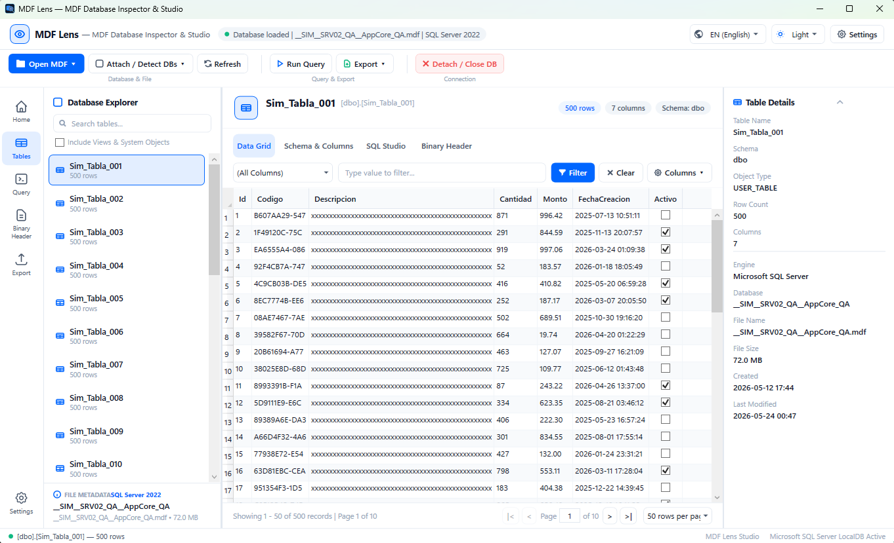
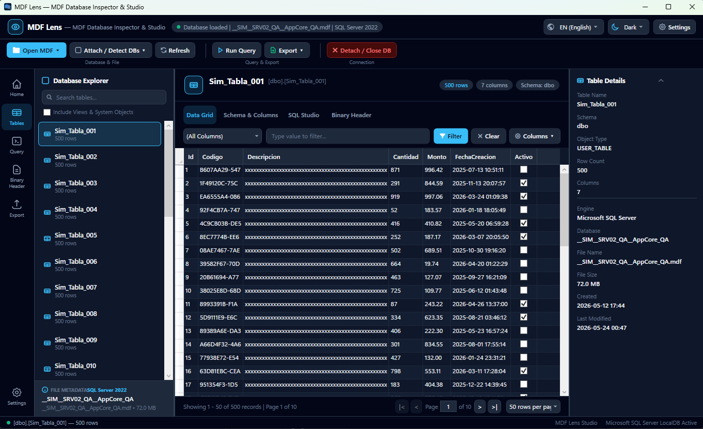
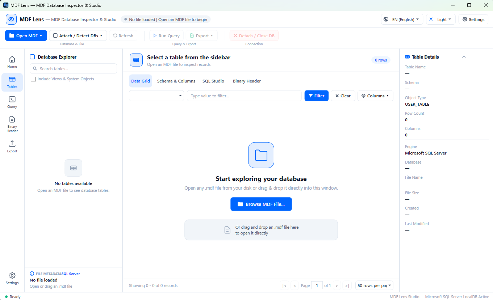
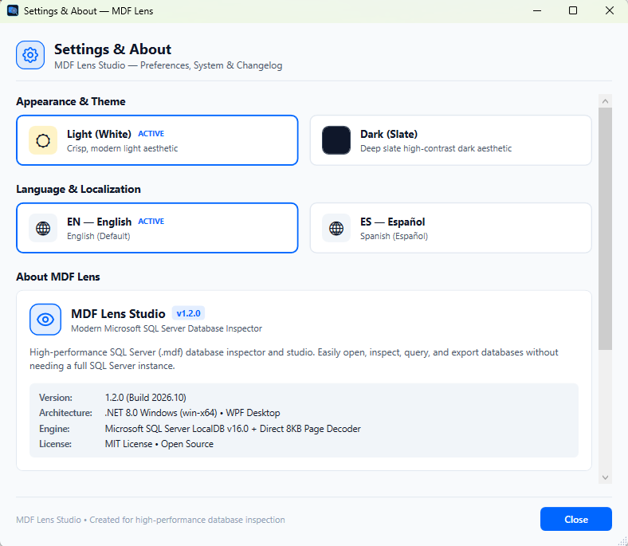

# MDF Lens Studio for Windows

<p align="center">
  
</p>

<p align="center">
  <strong>High-Performance Microsoft SQL Server Primary Data File (.mdf) Inspector & Studio</strong><br />
  Built with C#, WPF, and .NET 8 for Windows (win-x64)
</p>

<p align="center">
  <a href="#screenshots">Screenshots</a> •
  <a href="#key-features">Key Features</a> •
  <a href="#how-to-run-mdf-lens">How to Run</a> •
  <a href="#project-structure">Project Structure</a> •
  <a href="CHANGELOG.md">Changelog</a>
</p>

---

## Overview

**MDF Lens** is a modern, developer-first Microsoft SQL Server Primary Data File (`.mdf`) inspector, schema browser, and studio workspace. Designed with inspiration from professional database studios (DataGrip, TablePlus, SSMS), MDF Lens allows you to inspect raw MDF files, browse tables and schemas, execute custom queries, and export data without needing a full SQL Server instance installed.

---

## Screenshots

### 1. Studio Workspace (Light Mode)
*Full-featured 4-column studio layout: Activity Bar, searchable Database Explorer, paginated Data Grid, and real-time Inspector Panel.*



---

### 2. Studio Workspace (Dark Mode)
*Deep Slate high-contrast studio theme with customized controls, syntax highlighter, and adaptive iconography.*



---

### 3. Welcome & Drag-and-Drop Screen
*Clean startup view welcoming users to browse or drag-and-drop any `.mdf` file to begin immediate inspection.*



---

### 4. Settings & About Modal
*Centralized preferences for instant Light/Dark theme switching, bilingual English/Spanish localization, system architecture details, and embedded changelog viewer.*



---

## Key Features

### 1. Studio Multi-Panel Layout
* **Activity Bar (Far-Left)**: Fast switching between `Home`, `Tables`, `Query Studio`, `Binary Header`, `Export`, and `Settings`.
* **Database Explorer (Left Sidebar)**: Searchable list of database tables and views with real-time row counts, plus an integrated `FILE METADATA` summary.
* **Central Studio Workspace**:
  * **Header Breadcrumbs & Stat Pills**: Table name, schema, record counts, and column counts.
  * **Unified Column Filtering**: Fast filtering across `(All Columns)` or specific fields with instant matching.
  * **Segmented Tabs**:
    * **Data Grid**: Virtualized high-speed table browsing with formatted dates, numbers, and pagination.
    * **Schema & Columns**: Complete column definitions, SQL data types, max lengths, nullability, primary key, identity, and defaults.
    * **SQL Studio**: Custom `SELECT` query console with syntax execution and execution time profiling (<kbd>F5</kbd>).
    * **Binary Header**: Low-level 8KB page architecture inspection.
* **Inspector Panel (Right Sidebar)**: Real-time metadata for selected tables and databases (Object type, Row count, Engine, Database name, File size, and Timestamps).

### 2. Grouped Action Toolbar
* **Database & File**: `Open MDF ▾` (file picker and quick access), `Attach / Detect DBs ▾` (one-click detection of databases on the PC), and `Refresh`.
* **Query & Export**: `Run Query` shortcut and `Export ▾` (CSV, TSV/Excel, JSON, SQL INSERT scripts).
* **Connection**: `Detach / Close DB` (safely detaches temporary instances and cleans up locks).

### 3. Dual Theme & Internationalization (Bilingual)
* **Themes**: Instant runtime toggle between **Light** (crisp white modern UI) and **Dark** (deep slate studio mode) with custom-styled controls and ComboBox templates.
* **Languages**: Seamless switching between **English (EN)** and **Spanish (ES)** across all menus, tooltips, dialogs, and headers.
* **Default Settings**: Starts by default in **English** with the **Light (White)** theme.

### 4. Direct Binary Page Inspection (Offline)
* Directly parses **Page 0 (File Header)** and **Page 9 (Boot DBINFO Page)** from the raw MDF binary without requiring an active SQL Server instance:
  * Detects internal SQL Server edition (SQL 7.0, 2000, 2005, 2008, 2008 R2, 2012, 2014, 2016, 2017, 2019, 2022).
  * Extracts internal database name and total 8KB page counts.
  * Evaluates engine compatibility before mounting.

### 5. Microsoft SQL Server LocalDB Integration
* Leverages the native **LocalDB** instance (`MSSQLLocalDB`) installed on Windows.
* Auto-detects databases already attached or dynamically mounts detached `.mdf` files via safe attach procedures (`FOR ATTACH` / `FOR ATTACH_REBUILD_LOG`).

---

## Project Structure

```
C:\Google-Code\MDF\
├── .gitignore                     # Git ignore rules for .NET & Visual Studio
├── MDF-Lens.slnx                  # Solution file for Visual Studio / Rider
├── README.md                      # Project documentation and screenshot showcase
├── CHANGELOG.md                   # Version release notes and change history
├── Run_MdfLens.cmd                # Double-click launcher script
├── MDF Lens.lnk                   # Desktop / Workspace shortcut
├── Assets/                        # Application preview screenshots
│   ├── View1.png                  # Welcome / drag-and-drop start screen
│   ├── View2.png                  # Studio workspace (Light mode)
│   ├── View3.png                  # Settings & About modal dialog
│   └── View4.png                  # Studio workspace (Dark mode)
└── MdfLens/
    ├── MdfLens.csproj             # .NET 8 WPF project targeting win-x64
    ├── App.xaml / App.xaml.cs     # Startup configuration & unhandled exception handler
    ├── MainWindow.xaml / .cs      # Modern 4-panel studio UI and business logic
    ├── SettingsWindow.xaml / .cs  # Centralized Settings, About & Changelog dialog
    ├── app_icon.ico / app_icon.png# High-resolution application icons
    ├── Models/
    │   ├── MdfHeaderInfo.cs       # Binary header metadata model
    │   ├── TableItem.cs           # Database table entity & formatted row counter
    │   └── ColumnInfo.cs          # Column definitions & SQL constraints model
    └── Services/
        ├── MdfHeaderParser.cs     # Direct binary page decoder (Page 0 & Page 9)
        ├── SqlServerService.cs    # LocalDB attachment manager & paginated query engine
        ├── ThemeManager.cs        # Dynamic Light & Dark theme manager
        ├── LocalizationService.cs # Real-time English & Spanish dictionary provider
        └── ExportService.cs       # Multi-format data exporter (CSV, TSV, JSON, SQL)
```

---

## How to Run MDF Lens

### Option 1: Desktop Shortcut
Double-click the **MDF Lens** shortcut on your Desktop:
```
C:\Users\mjala\Desktop\MDF Lens.lnk
```

### Option 2: Run Launcher
Double-click `Run_MdfLens.cmd` in the project root:
```cmd
C:\Google-Code\MDF\Run_MdfLens.cmd
```

### Option 3: Direct Executable
```powershell
C:\Google-Code\MDF\MdfLens\bin\Release\net8.0-windows\win-x64\publish\MdfLens.exe
```

### Option 4: From Command Line (.NET CLI)
```powershell
dotnet run --project C:\Google-Code\MDF\MdfLens
```

Or open a specific `.mdf` file directly on launch:
```powershell
C:\Google-Code\MDF\MdfLens\bin\Release\net8.0-windows\win-x64\publish\MdfLens.exe "C:\Path\To\Database.mdf"
```
